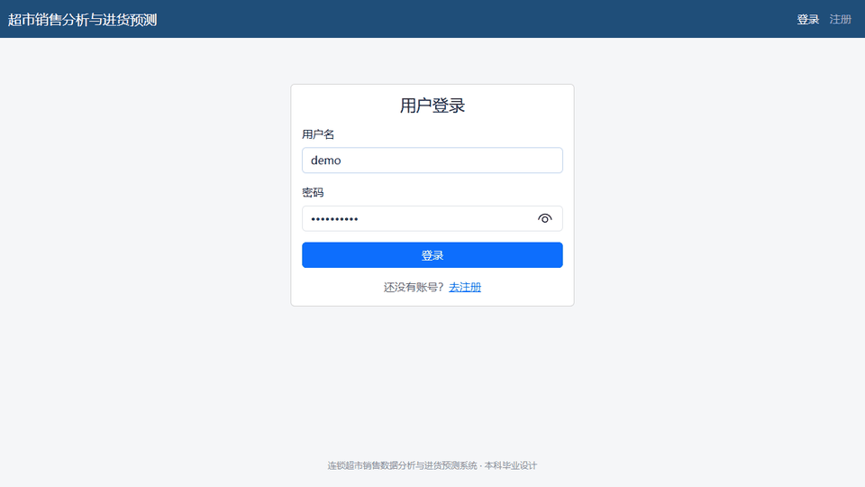
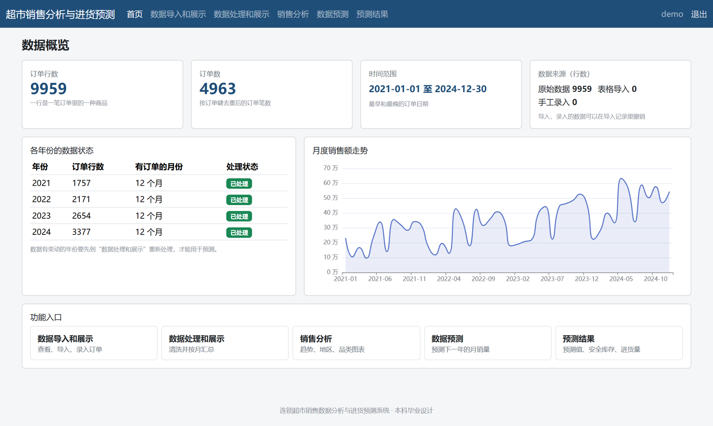
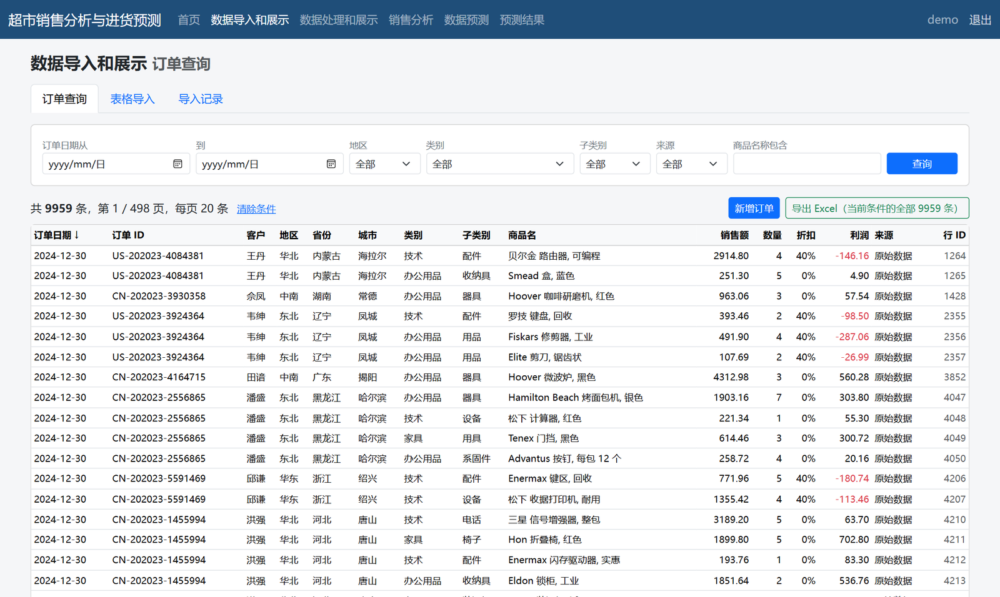
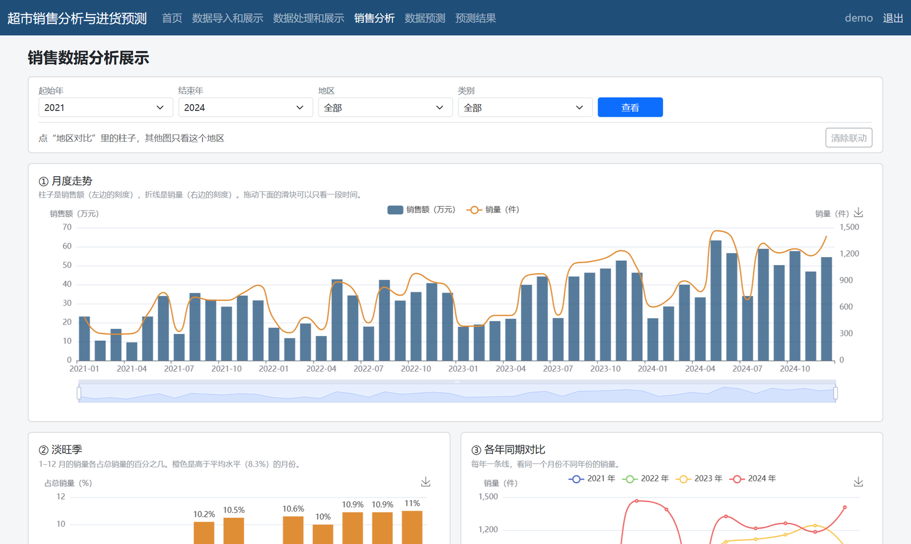
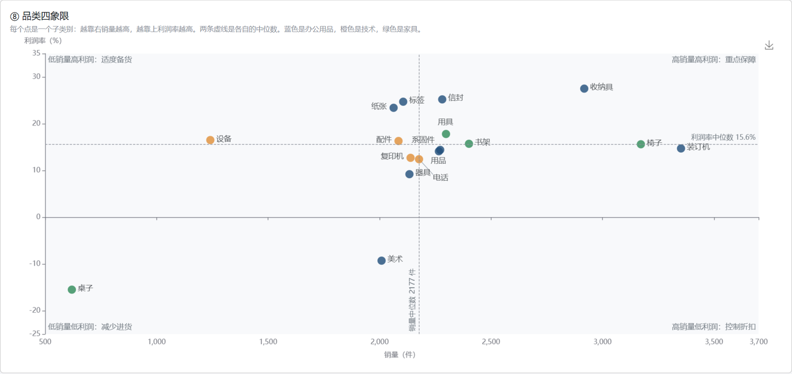
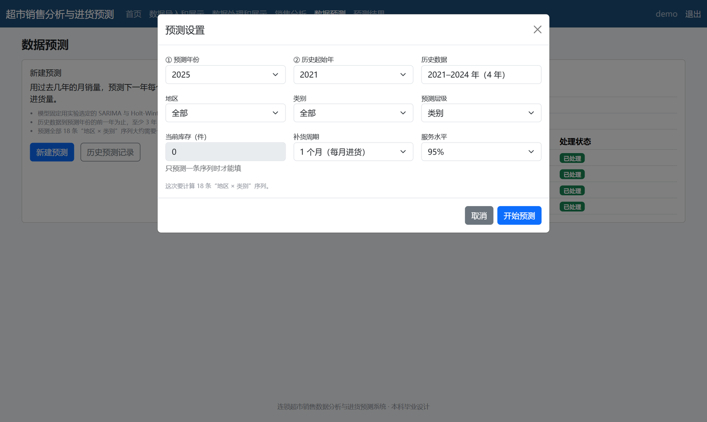
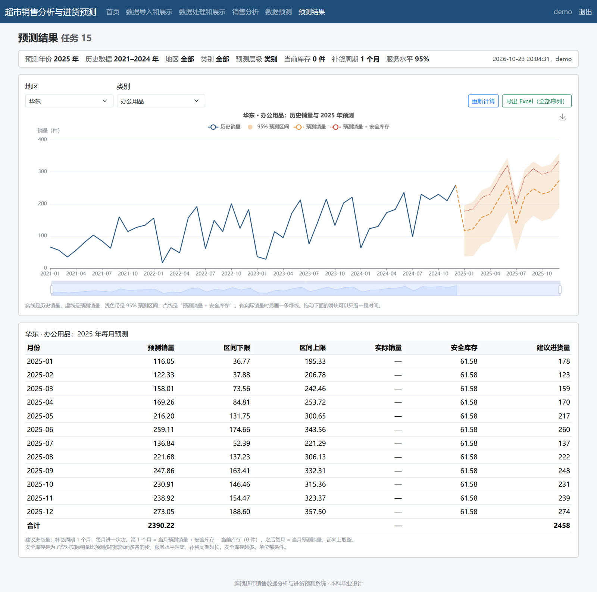

# 连锁超市销售数据分析与进货预测系统

用四年的超市订单数据，做数据清洗、销售分析和月度销量预测，再把预测结果换算成安全库存和建议进货量，最后做成一个可以登录使用的 Web 系统。

这是我的本科毕业设计。

- 在线展示页：<https://zhaozexu70.github.io/supermarket-sales-forecast/>
- 作者：Zhao Zexu



## 背景

超市进货多了会压库存，少了会断货。这个项目想回答一个具体的问题：**下个月每个地区、每个品类该进多少货？** 做法是先看清历史销售的规律（趋势、淡旺季、地区和品类差异），再用时间序列模型预测月销量，最后加上安全库存，给出进货建议。

## 数据

- 来源：阿里云天池公开数据集“超市销售数据”（<https://tianchi.aliyun.com/dataset/207075>）
- 这是**公开的模拟零售订单数据**，不是某家真实企业的数据
- 9959 条订单明细、20 个字段，时间 2021-01-01 至 2024-12-30，覆盖 6 个地区、3 个类别、17 个子类别
- 仓库里不附带原始数据，下载方法见 [data/README.md](data/README.md)

## 做法

### 1. 数据质量检查与修正

缺失值、重复行、取值越界都检查过，结果都是 0；真正的问题藏在业务字段里：

| 发现的问题 | 规模 | 处理方式 |
|---|---|---|
| 同一个订单 ID 被多笔不同订单重复使用 | 1403 个订单 ID | 改用“订单 ID + 日期 + 客户 ID”识别一笔订单，得到 4963 笔订单 |
| 订单 ID 里的年份比订单日期早一年 | 全部 9959 行 | 时间一律以订单日期为准 |
| 一个产品 ID 对应多个商品名 | 22 个 | 用“产品 ID + 商品名”识别商品 |
| 销售额、利润的离群值（IQR 法） | 1037 / 1839 行 | 只标记不删除：大单和亏损单是真实业务的一部分 |

### 2. 选择预测粒度

粒度太细，序列里大部分时间是 0，模型学不到东西。比较了几种汇总方式的零销量占比：

| 汇总粒度 | 零销量占比 |
|---|---|
| 周 × 地区 × 子类别 | 67.8% |
| 月 × 地区 × 子类别 | 27.8% |
| **月 × 地区 × 类别** | **4.3%** |

最后以“月 × 地区 × 类别”（18 条序列）为主层级建模；子类别的预测按近 12 个月的销量占比从上一层分配下来。

### 3. 模型对比

数据按时间顺序切分：2021–2022 年训练、2023 年验证（用来选方案），2021–2023 年训练、2024 年测试（只做最终评估）。对比了 5 种方案：

- 季节朴素法：直接用去年同月的销量，作为基准
- SARIMA：季节周期 12，阶数按 AIC 网格搜索
- Holt-Winters：阻尼趋势 + 加法季节
- 组合模型：SARIMA 和 Holt-Winters 的预测取平均
- LightGBM：18 条序列合在一起训练的全局模型，作为机器学习对照

### 4. 安全库存与进货量

- 安全库存 = z × σ × √L：z 由服务水平决定（95% 时取 1.65），σ 取模型在测试期的 RMSE，L 是补货周期（月）
- 第 1 个月建议进货 = 预测销量 + 安全库存 − 当前库存，之后每月补当月的预测销量

## 主要结果

18 条“地区 × 类别”序列的整体 WAPE（加权绝对百分比误差，越低越好）：

| 方案 | 验证集（2023） | 测试集（2024） | 测试集平均 RMSE | 测试集 R² |
|---|---|---|---|---|
| 季节朴素法（基准） | 42.2% | 40.3% | 30.29 | 0.621 |
| Holt-Winters | 40.4% | 33.1% | 24.92 | 0.752 |
| SARIMA | 44.7% | 36.8% | 27.35 | 0.705 |
| **组合模型（最终采用）** | 41.2% | 33.8% | 25.14 | **0.754** |
| LightGBM | 35.0% | 34.2% | 25.32 | 0.726 |

- 组合模型比基准低 6.5 个百分点。它在两个阶段都和最好的单模型相差不到 1 个百分点，而且避免了单个模型偶尔失手（华北-技术这条序列上 SARIMA 的 RMSE 是 40.1，组合后 27.3）
- LightGBM 验证集最好，但那是 36 组参数里挑出来的，偏乐观；测试集上它不如组合模型，并且整体预测偏低约 16%（树模型不会外推逐年增长的趋势）
- 月销量本身波动大，WAPE 在 33% 左右，所以预测值要配合安全库存使用
- 分析结论举例：5–6 月和 8–12 月是旺季，每月约占全年销量 10%–11%；华东和中南两个地区占销售额 54.9%；桌子平均折扣 39.1%，四年累计亏损约 13.3 万元

## 系统截图

| 首页概览 | 订单查询 |
|---|---|
|  |  |
| **销售分析：月度走势与淡旺季** | **销售分析：品类四象限** |
|  |  |
| **预测设置** | **预测结果：走势、区间、安全库存、进货量** |
|  |  |

截图来自演示数据库，账号是临时创建的演示账号。

## 系统功能

- 登录、注册（密码加盐哈希存储，连续输错会临时锁定）
- 数据导入：下载模板 → 上传 Excel/CSV → 逐行校验并预览 → 确认导入；也可以在对话框里逐条录入；导入批次可以撤销
- 订单查询：按日期、地区、类别筛选，按商品名搜索，分页，导出 Excel
- 数据处理：按年份清洗并按月汇总，显示处理摘要和月度走势
- 销售分析：8 张 ECharts 图（月度趋势、淡旺季、各年同期、地区、品类、地区 × 子类别热力图、品类四象限等），点地区柱子可联动筛选其他图
- 数据预测：选预测年份、历史范围、地区、类别、补货周期和服务水平；在后台线程里并行计算，页面显示进度；相同条件、数据没变时直接复用上次结果
- 预测结果：历史 + 预测走势图（含 95% 预测区间）、每月预测表、安全库存、建议进货量，导出 Excel

## 技术栈

| 层 | 用到的东西 |
|---|---|
| 数据处理与建模 | Python、pandas、NumPy、statsmodels（SARIMA、Holt-Winters）、LightGBM、Matplotlib |
| 后端 | Flask、SQLAlchemy、PyMySQL、Flask-WTF（CSRF） |
| 数据库 | MySQL 8（11 张表） |
| 前端 | Bootstrap 5、ECharts 5（都放在本地，不依赖 CDN） |
| 测试 | pytest、Playwright（用本机 Edge 跑端到端测试） |

## 运行方法

需要 Python 3.10 及以上和 MySQL 8。

```bash
pip install -r requirements.txt

# 1. 配置数据库账号：复制 .env.example 为 .env，填上自己的 MySQL 密码
cp .env.example .env

# 2. 下载数据，放到 data/raw/超市销售数据.xlsx（见 data/README.md）

# 3. 清洗数据、生成按月汇总表
python src/step1_preprocess.py

# 4. 建库建表并导入数据（库名默认 supermarket_db）
python src/step3_load_mysql.py
python src/step3_load_mysql.py --results   # 导入模型评估和预测结果

# 5. 创建账号并启动系统，浏览器打开 http://127.0.0.1:5000
python run.py --create-admin
python run.py
```

想复现实验：

```bash
python src/step2_eda.py          # 描述性统计和分析图
python src/step4_model.py        # 模型训练、验证、测试、预测（几分钟）
python src/step5_ml_compare.py   # LightGBM 对比实验
```

自动测试只连测试库 `supermarket_db_test`（每次会删掉重建），需要先完成上面的第 1–3 步：

```bash
python -m pytest tests -q
```

## 项目结构

```
├── app/                    Flask 系统
│   ├── views/              页面路由（数据、处理、分析、预测）
│   ├── services/           业务逻辑（导入校验、汇总、分析、预测任务）
│   ├── templates/          页面模板
│   └── static/             JS、CSS，以及本地的 Bootstrap 和 ECharts
├── src/
│   ├── config.py           路径、数据划分、模型参数、数据库连接（从 .env 读取）
│   ├── preprocess_core.py  清洗、去重、异常标记、按月汇总补零（实验和系统共用）
│   ├── forecast_core.py    SARIMA、Holt-Winters、组合模型、安全库存（实验和系统共用）
│   ├── forecast_worker.py  系统里计算一条序列
│   ├── step1 ~ step5       实验脚本：预处理、探索分析、入库、建模、机器学习对比
│   └── migrate_v2.py、db_backup.py   数据库升级和备份工具
├── sql/schema.sql          建表语句
├── tests/                  pytest 单元测试和 Playwright 端到端测试
├── outputs/
│   ├── figures/            实验图表
│   ├── tables/             实验结果表（数据质量、模型评估、预测结果）
│   └── models/model_config.json   每条序列选出的模型阶数和误差
├── docs/                   GitHub Pages 展示页和截图
├── data/README.md          数据下载说明
└── run.py                  启动入口
```

## 说明

- 数据是公开的模拟数据，结论用来说明方法，不代表任何真实企业的经营情况
- 预测区间沿用 SARIMA 95% 区间的宽度，是近似处理
- 训练数据只有 36–48 个月，季节参数的估计不算稳定，这是这个项目最主要的局限
